# Triad DMS

A document management system with dynamic metadata, division-based access control, cross-division access requests and OCR search. Built as the Triad AI full stack internship assignment.

[](https://github.com/ishikabarnwal/Triad-dms/actions/workflows/tests.yml)


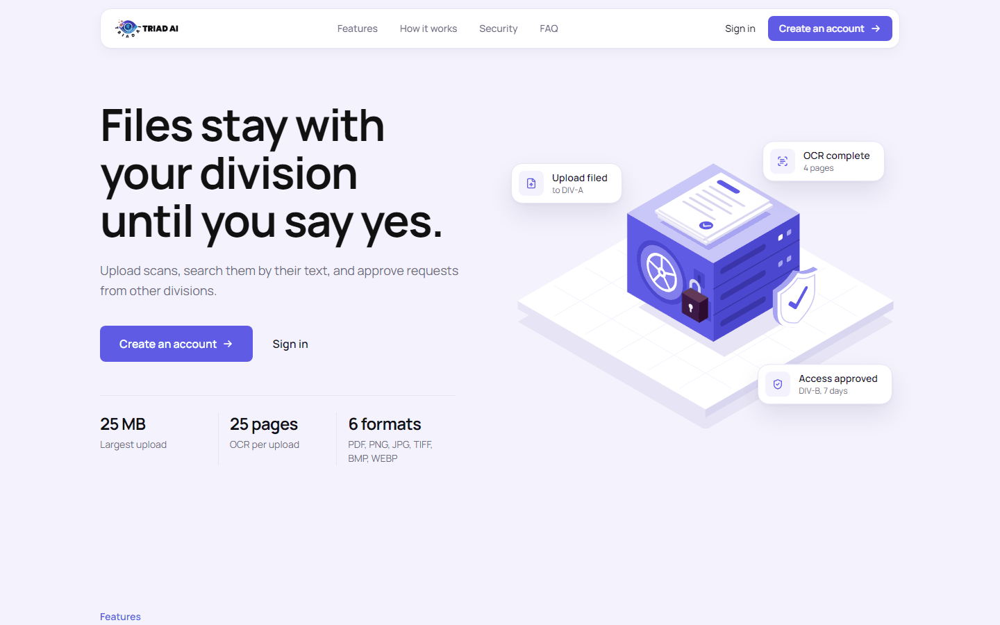

## Live demo

Live demo: coming soon

Demo accounts (created by the demo seed, see [Getting started](#getting-started)):

| Account | Email | Division | Password |
|---|---|---|---|
| Super admin | `admin@example.com` (username `admin`) | Headquarters | the `ADMIN_PASSWORD` in your `.env` |
| Asha Verma | `asha.verma@example.com` | Division A | `Demo@12345` |
| Ravi Menon | `ravi.menon@example.com` | Division A | `Demo@12345` |
| Meera Rao | `meera.rao@example.com` | Division B | `Demo@12345` |
| Arjun Singh | `arjun.singh@example.com` | Division B | `Demo@12345` |

These are demo credentials only. Never reuse them on a real deployment.

## Contents

- [Features](#features)
- [Screenshots](#screenshots)
- [Architecture](#architecture)
- [Data model](#data-model)
- [Access control](#access-control)
- [OCR and search](#ocr-and-search)
- [API reference](#api-reference)
- [Getting started](#getting-started)
- [Testing](#testing)
- [Notes for evaluators](#notes-for-evaluators)
- [Design decisions and trade-offs](#design-decisions-and-trade-offs)
- [Project structure](#project-structure)
- [Security notes](#security-notes)
- [What I would do next](#what-i-would-do-next)
- [Author](#author)

## Features

### Dynamic metadata

- Fields live in the `metadata_fields` collection, not in code. Each has a key, label, type (`text`, `select`, `number`, `date`), options, display order and three flags: required, filterable, searchable.
- Uploads are validated against the active fields: required values, select options, numbers and ISO dates. Unknown keys are kept rather than rejected.
- Any query parameter on `GET /api/documents` that isn't a reserved word filters on metadata, e.g. `?Report Type=Financial`. Number and date filters are converted to the field's type first.
- Admins add, edit, reorder, hide and restore fields from the Settings page. A field's key and type lock once documents use it, and reserved words (`page`, `limit`, `q`, `scope` and the other list parameters) can't be used as keys.
- The upload form, filter bar, document page and search filters are all built from the field list at runtime.

### RBAC and division isolation

- Every user belongs to one division. Passwords are hashed with bcrypt and sessions use HS256 JWTs that expire after 8 hours.
- Members upload only to their own division (403 otherwise); the super admin can upload to any division.
- Files, previews and OCR text are served only to the owning division, to holders of an approved and unexpired access request, and to the super admin. Everyone else gets 403.
- The rules live in one place (`app/utils.py`) and every route reuses them: listing, details, download, preview, search and stats.

### Cross-division access requests

- Any user can see the title and metadata of other divisions' documents and ask for access with an optional reason.
- Only one pending request per user and document is allowed. MongoDB enforces this with a partial unique index, and a second request returns 409 with the existing one.
- Anyone in the owning division (or the super admin) can approve, with an optional expiry of 1 to 365 days (the UI offers none, 7, 30 or 90), or reject with a note. Nobody can decide their own request.
- Decisions are single conditional updates ("only if still pending"), so two reviewers can't both decide the same request.
- Requesters see each status with its details and can ask again after a rejection, revocation or expiry.

### OCR and search

- PDFs use their embedded text layer first. Pages with almost no text are rendered and read by Tesseract. Images (PNG, JPG, TIFF including multi-page, BMP, WebP) go straight to Tesseract.
- Extraction never fails an upload. Unreadable files are stored with `ocr_status: "failed"` and a short `ocr_error`.
- `GET /api/search` combines a weighted MongoDB text index (title, metadata values, OCR text) with a partial-word pass, so `fin` finds "Financial". Results are ranked, show where each one matched, and carry a highlighted snippet.
- Search combines with every document filter: division, upload date range, text status and any metadata field.

### Beyond the brief

- **Expiring and revocable access.** Approvals can expire, and the owning division can revoke them at any time. Expired or revoked access stops downloads immediately.
- **Audit log.** Uploads, downloads, previews, denied attempts, access requests and decisions, sign-ins, failed sign-ins and every admin change are recorded with actor, divisions, IP and details. Admins can filter the log by action group, person, division and date.
- **Rate-limited login.** Failed sign-ins are limited to 10 per minute per client. Counts are stored in MongoDB, so every gunicorn worker shares them.
- **Content-type verification.** The file type comes from the file's leading bytes, not the client's `Content-Type` or extension. A renamed executable is rejected with 400.
- **Confidentiality-safe search.** For documents you can't open, OCR text never counts as a match and is never returned, so search results can't reveal what a restricted file says.
- **Command palette.** Ctrl K finds documents and pages from anywhere; G D, G S, G A and G C jump to the dashboard, search, access requests and (for admins) settings.
- **Admin settings.** Metadata fields, divisions (a rename carries through users, documents and requests), users (division and role changes) and the audit log.
- **CI.** GitHub Actions runs the backend suite, both evaluator scripts against a live gunicorn server, and the frontend tests and build on every push.
- **Demo data.** One command loads four users, 14 documents (three of them scanned images) and access requests in every state, spread over three weeks.

## Screenshots

| | |
|---|---|
| 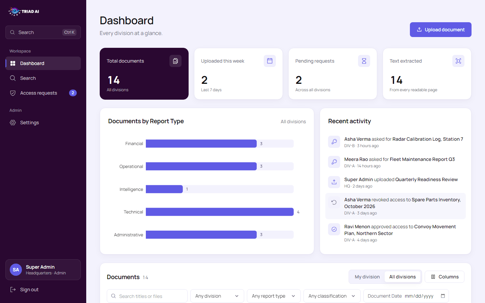 **Dashboard** as the super admin: totals, documents by report type, recent activity and the filterable table. | 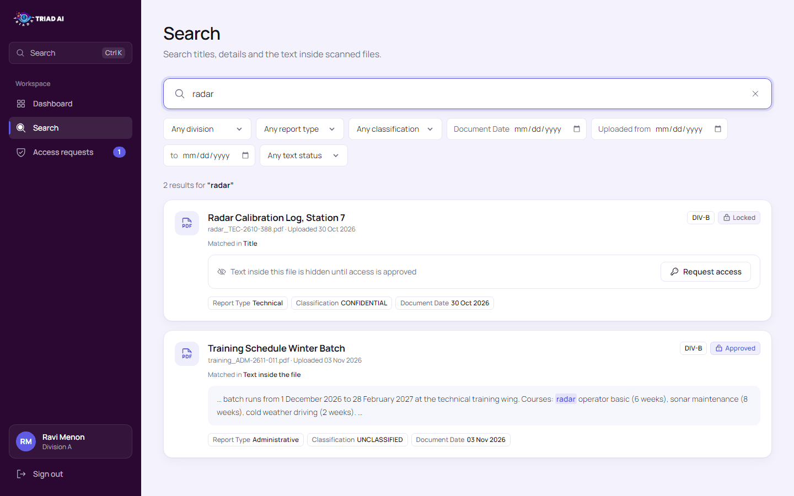 **Search** as a Division A user: a Division B file shows only its title and details, while a shared file shows its highlighted text. |
| 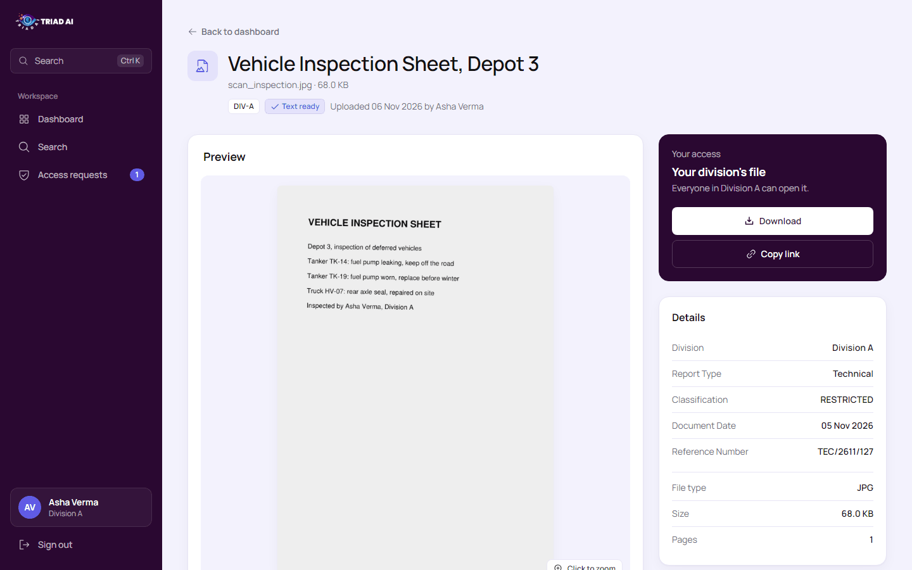 **Document page** for a scanned JPG, read by OCR, with its details and actions. | 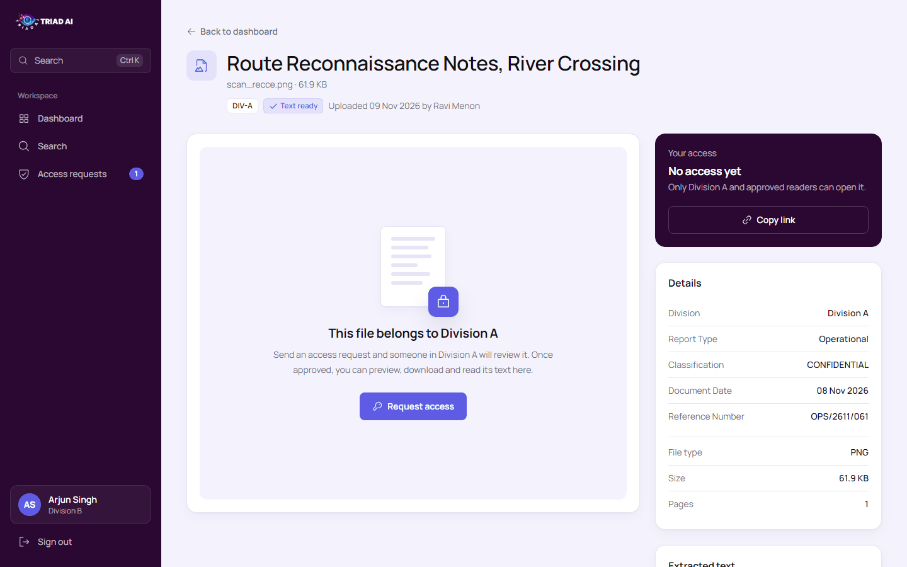 **Locked document** seen from Division B, with the access request call to action. |
| 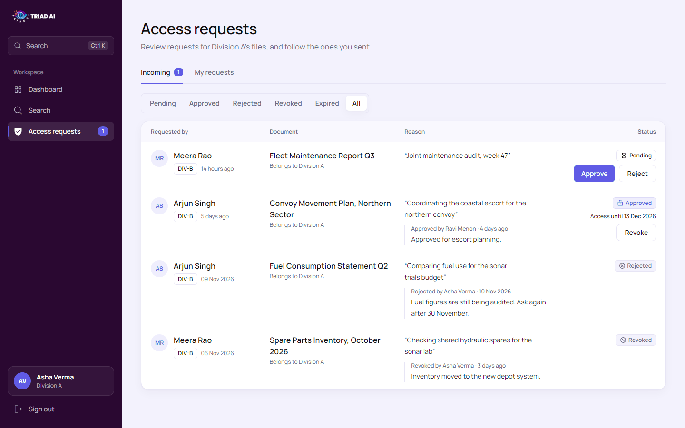 **Access requests**, incoming tab: pending, approved, rejected and revoked requests with their notes. | 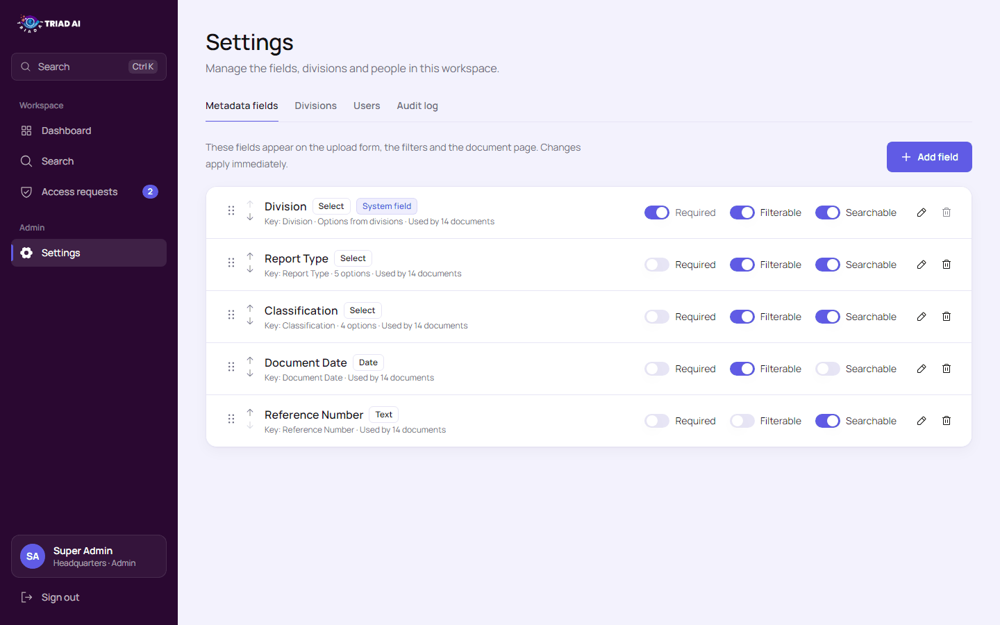 **Settings, metadata fields**: order, type, usage and the three switches per field. |
| 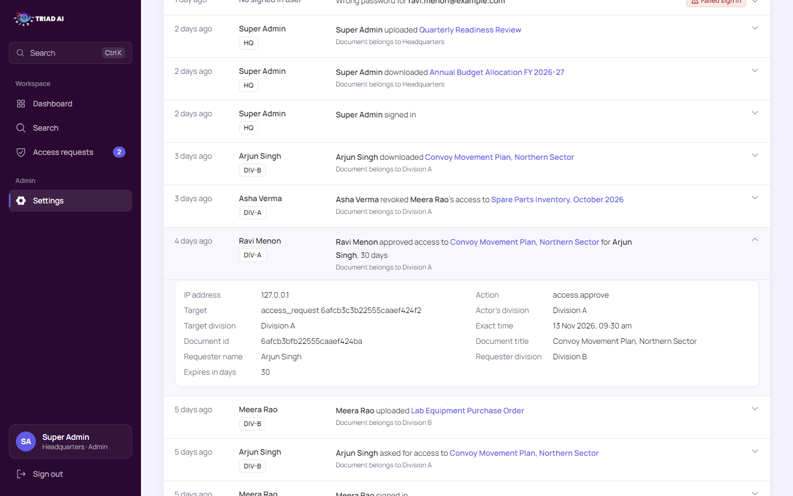 **Audit log** with readable entries and one expanded to show its raw details. | 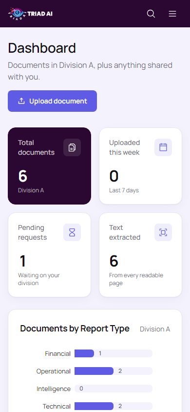 **Dashboard at 390px** wide. |

## Architecture

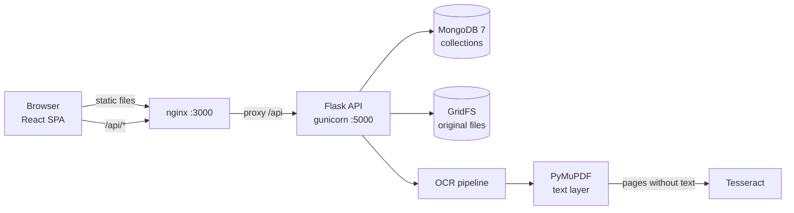

**Frontend.** React 18 with Vite, React Router, Tailwind CSS v4 and shadcn/ui components on Radix primitives. One axios client adds the JWT and logs the user out on any 401. Every screen is lazy loaded, and the metadata fields are fetched once and drive all forms and filters. In Docker the build is served by nginx, which also proxies `/api` to the backend, so the browser talks to one origin.

**API.** Flask 3 with an app factory and one blueprint per area: `auth`, `documents`, `access`, `search`, `catalog`, `stats`, `admin` and `health`. Every request body and query string is validated by a Pydantic v2 model, and every error has the same `{ "error": "<code>", "message": "..." }` shape. Gunicorn runs three workers.

**Storage.** MongoDB holds the records, and GridFS holds the uploaded files, so there is one system to back up and nothing on local disk. Indexes are created at startup. The per-field metadata indexes are re-synced whenever an admin changes a field.

**OCR.** It runs inside the upload request, so the response already says whether text was found. PyMuPDF reads the text layer without any external tools, and Tesseract (installed in the backend image) reads only what has no text layer.

## Data model

| Collection | Key fields |
|---|---|
| `divisions` | `name` (unique), `code` (unique when set), `description`, `created_at` |
| `users` | `name`, `email` (unique, lowercase), `username` (unique when set), `password_hash`, `division` (name), `role` (`member` or `admin`), `created_at`, `last_login_at` |
| `metadata_fields` | `key` (unique), `label`, `type`, `options`, `required`, `filterable`, `searchable`, `order`, `active`, `source` (`divisions` for the built-in Division field), `locked` |
| `documents` | `title`, `filename`, `content_type`, `size`, `sha256`, `gridfs_id`, `division`, `metadata` ({key: value}), `search_blob`, `ocr_text`, `ocr_status`, `ocr_error`, `page_count`, `uploaded_by`, `upload_source`, `created_at` |
| `access_requests` | `document_id`, `document_title`, `requester_id`, `requester_division`, `owner_division`, `reason`, `status`, `decided_by`, `decision_note`, `decided_at`, `expires_at`, `revoked_by`, `revoke_note`, `revoked_at`, `created_at` |
| `audit_logs` | `action` (e.g. `document.download`, `access.approve`, `auth.login_failed`), `actor_id`, `actor_name`, `actor_division`, `target_type`, `target_id`, `division`, `details`, `ip`, `created_at` |
| `fs.files`, `fs.chunks` | GridFS storage for the original files |

**Why definitions plus values.** Metadata is split in two. `metadata_fields` holds the definitions: what a field is called, its type, its options and how it behaves. Each document stores only its values in one `metadata` object keyed by the field's key. Adding a field is an insert into `metadata_fields`, with no schema migration and no code change. Validation, forms and filters read the definitions at runtime. Old documents keep values for fields that are later hidden, because deleting a field only sets `active: false`.

**Keeping filters and indexes dynamic.**
- Filters are generic: any non-reserved query parameter becomes a condition on `metadata.<key>`, converted to the field's type.
- Speed comes from `sync_metadata_indexes`, which creates or drops one index per active filterable field. It runs at startup and after every field change.
- The text index covers `title`, `search_blob` (all searchable metadata values joined) and `ocr_text`. It has fixed field names, so it never needs rebuilding when fields change.

`document.division` and `metadata.Division` always hold the same value, and a division rename updates every record that stores the name.

## Access control

| Action | Member, own division | Member, other division | Super admin |
|---|---|---|---|
| Upload | Yes | No (403) | Any division |
| See title and metadata (list `scope=all`, search) | Yes | Yes | Yes |
| Preview, download, read OCR text | Yes | Only with an approved, unexpired request | Yes |
| Request access | Not needed | Yes, one pending at a time | Not needed |
| Approve, reject or revoke a request | Yes, for their division's documents, never their own request | No | Yes |
| Settings and audit log | No | No | Yes |

Uploads without a token are a special case for the evaluators' script; see [Notes for evaluators](#notes-for-evaluators).

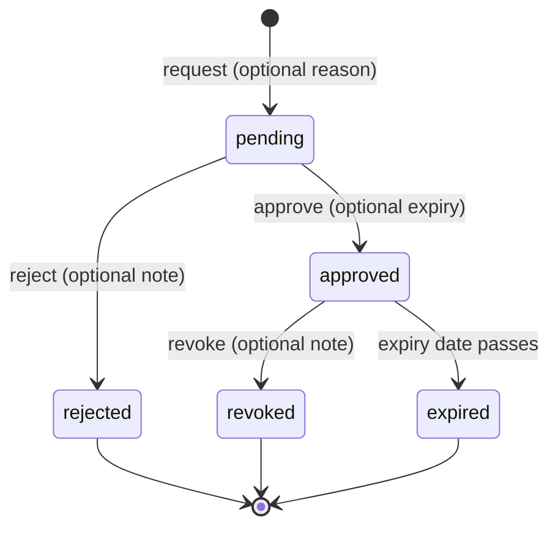

After a rejection, revocation or expiry the requester can send a new request, which starts again at pending.

## OCR and search

**Extraction** (`app/ocr.py`):
- PDFs are opened with PyMuPDF and each page's text layer is read.
- A page with fewer than 20 characters is treated as a scan. It is rendered at 200 dpi and read by Tesseract (`OCR_LANGUAGES`, English by default).
- At most `OCR_MAX_PAGES` (25) scanned pages are OCR'd per upload, with `OCR_PAGE_TIMEOUT` (60 seconds) per page. Stored text is capped at 2 million characters.
- Images go to Tesseract directly; multi-page TIFFs frame by frame.
- Any failure (an encrypted PDF, a PDF with no pages, a Tesseract timeout) is caught. The document is stored with `ocr_status: "failed"` and the reason in `ocr_error`. `OCR_ENABLED=false` skips extraction and stores `ocr_status: "skipped"`.

**Search** (`app/search.py`, `GET /api/search?q=`):
1. **Text index.** The query runs against the MongoDB text index, weighted title 10, metadata 5, OCR text 1, which matches whole words with stemming.
2. **Partial words.** A second pass with case-insensitive regexes requires every term to appear somewhere, even inside a longer word.
3. **Ranking.** Text-index hits come first by score, then partial-only hits, newest first. Each pass is capped at 500 candidates.
4. **Match locations.** Each candidate is checked to record where it matched: title, which metadata fields, or text inside the file.
5. **Snippets.** About 200 characters around the first content match. Everything is HTML-escaped except the `<mark>` tags around matches, and the frontend renders the parts as text, never as HTML.

**Why other divisions never see OCR text.** For a document you can't open:
- OCR text does not count as a match, so the document only appears if its title or metadata matched.
- No snippet is returned, and the response never includes `ocr_text`.

A search for a codeword that only appears inside another division's file returns nothing, which is what keeps search from leaking content.

## API reference

All routes are under `/api` on port 5000. Send `Authorization: Bearer <token>`. IDs are returned as strings in `id`, plus `doc_id` or `request_id` where the brief names them. **Required** marks the endpoints the assignment specifies.

| Method | Path | Auth | Description |
|---|---|---|---|
| GET | `/api/health` | None | Database and Tesseract status |
| POST | `/api/auth/register` | None | **Required.** Create a member account: `name`, `email` or `username`, `password`, `division`. Returns 201 with a token |
| POST | `/api/auth/login` | None | **Required.** Email or username plus password. Returns `token`, `access_token` and `user` |
| GET | `/api/auth/me` | Token | The signed-in user |
| GET | `/api/divisions` | None | Division names and codes (the sign up page needs them) |
| GET | `/api/config/public` | None | Upload size limit, OCR page limit and accepted file types |
| GET | `/api/metadata-fields` | Token | Active metadata fields in display order |
| POST | `/api/documents/upload` | Token or anonymous | **Required.** Multipart `file`, `metadata` (JSON string), optional `title`. Returns 201 |
| GET | `/api/documents` | Token | **Required.** List with `scope`, `page`, `limit`, `sort`, `order`, `q`, `division`, `date_from`, `date_to`, `ocr_status` and any metadata key as a filter |
| GET | `/api/documents/<doc_id>` | Token | Details with `access_status`, `can_download` and the viewer's latest request. OCR text only with access |
| GET | `/api/documents/<doc_id>/download` | Token | **Required.** Streams the file from GridFS, 403 without access |
| GET | `/api/documents/<doc_id>/preview` | Token | Same as download, served inline |
| GET | `/api/search` | Token | **Required.** `q` plus the same filters as the list. Ranked results with `matched_in` and `snippet` |
| POST | `/api/access/request` | Token | **Required.** `{ "doc_id": ..., "reason": optional }`. 409 if one is already pending |
| POST | `/api/access/approve` | Token | **Required.** `{ "request_id": ..., "expires_in_days": optional, "note": optional }` |
| POST | `/api/access/reject` | Token | `{ "request_id": ..., "note": optional }` |
| POST | `/api/access/revoke` | Token | `{ "request_id": ..., "note": optional }` for an active approval |
| GET | `/api/access/inbox` | Token | Requests for my division's documents (all divisions for the admin). `status`, `doc_id`, `division` (admin), `page`, `limit` |
| GET | `/api/access/mine` | Token | Requests I sent, with live status |
| GET | `/api/access/pending-count` | Token | Pending requests waiting on me |
| GET | `/api/stats` | Token | Dashboard totals, a breakdown by a select field, and recent activity |
| GET | `/api/admin/metadata-fields` | Admin | All fields, including hidden ones, with usage counts |
| POST | `/api/admin/metadata-fields` | Admin | Create a field |
| PUT | `/api/admin/metadata-fields/reorder` | Admin | `{ "ids": [...] }` in the new order |
| PUT | `/api/admin/metadata-fields/<field_id>` | Admin | Edit a field, or restore it with `active: true` |
| DELETE | `/api/admin/metadata-fields/<field_id>` | Admin | Hide a field (soft delete) |
| GET | `/api/admin/divisions` | Admin | Divisions with user and document counts |
| POST | `/api/admin/divisions` | Admin | Create a division |
| PUT | `/api/admin/divisions/<division_id>` | Admin | Edit or rename a division (the rename carries through) |
| DELETE | `/api/admin/divisions/<division_id>` | Admin | Delete an empty division, 409 while it has users or documents |
| GET | `/api/admin/users` | Admin | Users, with `q`, `division` and `role` filters |
| PUT | `/api/admin/users/<user_id>` | Admin | Change a user's `division` or `role`; admins can't demote themselves |
| GET | `/api/admin/audit-logs` | Admin | Audit log with `action` (comma-separated prefixes), `actor`, `division`, `date_from`, `date_to` |

Errors use `400` validation, `401` missing or invalid token, `403` forbidden, `404` not found, `409` conflict, `413` too large and `429` rate limited.

### Example: upload

```bash
curl -X POST http://localhost:5000/api/documents/upload \
  -H "Authorization: Bearer $TOKEN" \
  -F "file=@fuel_q2.pdf;type=application/pdf" \
  -F 'metadata={"Report Type": "Financial", "Classification": "CONFIDENTIAL"}' \
  -F "title=Fuel Consumption Statement Q2"
```

```json
{
  "message": "Document uploaded.",
  "id": "6afcb730f74ef600fe1fc8c0",
  "doc_id": "6afcb730f74ef600fe1fc8c0",
  "title": "Fuel Consumption Statement Q2",
  "filename": "fuel_q2.pdf",
  "content_type": "application/pdf",
  "size": 812,
  "division": "Division A",
  "metadata": { "Report Type": "Financial", "Classification": "CONFIDENTIAL", "Division": "Division A" },
  "ocr_status": "done",
  "ocr_error": null,
  "ocr_chars": 51,
  "page_count": 1,
  "uploaded_by": "6afcb730f74ef600fe1fc8bc",
  "uploaded_by_name": "Asha Verma",
  "upload_source": "user",
  "created_at": "2026-11-17T20:21:04.313906+00:00",
  "access_status": "owner",
  "can_download": true
}
```

The division defaults to the uploader's own, and `metadata.Division` is always set to match it.

### Example: search

```bash
curl "http://localhost:5000/api/search?q=convoy" -H "Authorization: Bearer $TOKEN"
```

```json
{
  "query": "convoy",
  "terms": ["convoy"],
  "results": [
    {
      "id": "6afcb730f74ef600fe1fc8c0",
      "title": "Fuel Consumption Statement Q2",
      "division": "Division A",
      "metadata": { "Report Type": "Financial", "Classification": "CONFIDENTIAL", "Division": "Division A" },
      "ocr_status": "done",
      "access_status": "owner",
      "can_download": true,
      "can_request_access": false,
      "matched_in": ["content"],
      "matched_keys": [],
      "snippet": "Fuel consumption rose on the northern <mark>convoy</mark> route.",
      "score": 0.583
    }
  ],
  "total": 1,
  "page": 1,
  "limit": 20,
  "pages": 1
}
```

Each result also carries the same document fields as the upload response; they are trimmed here for length.

## Getting started

Prerequisites: [Docker Desktop](https://www.docker.com/products/docker-desktop/) (or Docker Engine with the Compose plugin) and Git. Ports 3000, 5000 and 27017 must be free.

```bash
git clone https://github.com/ishikabarnwal/Triad-dms.git
cd Triad-dms
cp .env.example .env            # PowerShell: Copy-Item .env.example .env
docker compose up -d --build
docker compose exec backend python -m app.demo_seed --reset
```

Then open:

| | URL |
|---|---|
| App | http://localhost:3000 |
| API | http://localhost:5000/api |
| Health check | http://localhost:5000/api/health |

**Before deploying anywhere real**, edit `.env`: set a long random `JWT_SECRET` (e.g. `python -c "import secrets; print(secrets.token_hex(32))"`), a strong `ADMIN_PASSWORD` and `ALLOW_ANONYMOUS_UPLOAD=false`. The admin account is created from `.env` the first time the backend starts.

**What the demo seed does.** Every step goes through the real API in-process, so uploads are stored in GridFS, read by OCR and audited exactly like a real upload. Each step is then dated over the past three weeks. `--reset` first removes documents, stored files, access requests, audit logs and non-admin users; divisions, metadata fields and admins are kept. Without `--reset` the seed refuses to run on a database that already has documents.

### Run without Docker

Needs Python 3.12 or 3.13, MongoDB 7 on `localhost:27017`, Tesseract on your `PATH` (or set `TESSERACT_CMD` in `.env`, e.g. `C:/Program Files/Tesseract-OCR/tesseract.exe`) and Node.js 22.

```bash
python -m venv .venv
source .venv/bin/activate        # Windows: .venv\Scripts\activate
pip install -r requirements.txt
cp .env.example .env
python run.py                     # seeds, then serves the API on http://localhost:5000

# in a second terminal
cd frontend
npm ci
npm run dev                       # http://localhost:5173, proxies /api to port 5000
```

Load the demo data with `python -m app.demo_seed --reset`.

## Testing

| Suite | Command | Result |
|---|---|---|
| Backend (pytest, real MongoDB) | `docker compose run --rm tests` | 383 passed |
| Frontend unit tests | `cd frontend && npm ci && npm test` | 6 passed |
| Evaluators' script | `python test_api.py` | 1 of 1 passed |
| Extended evaluator-style script | `python test_api_extended.py` | 28 of 28 passed |

- **Backend suite.** The pytest suite runs in its own image against the Compose MongoDB, using a throwaway `triad_dms_test` database. It covers auth, upload and OCR, filters, RBAC, every access request transition, search confidentiality, admin endpoints, the audit log, robustness against malformed input, and the demo seed.
- **API scripts.** Both scripts call the running API on port 5000 and need `requests` (`pip install requests`). `test_api.py` is the evaluators' file, unchanged; it writes its result to `test_report.txt`.
- **CI.** [GitHub Actions](.github/workflows/tests.yml) runs on every push and pull request. One job runs the pytest suite, starts gunicorn, and runs both API scripts against it. A second job runs the frontend tests and production build.

## Notes for evaluators

**`ALLOW_ANONYMOUS_UPLOAD`.** The provided `test_api.py` uploads without an `Authorization` header and expects 200 or 201. With `ALLOW_ANONYMOUS_UPLOAD=true` (the default, so the script passes out of the box):
- An upload without a token is accepted. Its division comes from `metadata["Division"]`, which must name an existing division.
- It is stored with `uploaded_by: null` and `upload_source: "anonymous"`.
- As soon as a token is present, the normal rules apply in full: the division must be the uploader's own, or the request gets 403.

The flag exists only for that script. Set it to `false` in production, and anonymous uploads then get 401.

**`test_sample.pdf`.** The script's sample is `%PDF-1.4` followed by 1 KB of filler and `%%EOF`; it has no pages. It passes the content check (it does start with `%PDF`), so it is stored in GridFS like any other file. Text extraction fails, and the document is saved with `ocr_status: "failed"`, `ocr_error: "Failed to open stream"`, `ocr_text: ""` and `page_count: 0`. The API still returns 201, because an OCR failure never fails an upload. The document page says the PDF has no pages to show and offers the original as a download.

**Seed data.** The seed always provides divisions named exactly "Division A" and "Division B" and a metadata field with key exactly "Report Type" that includes the option "Financial", as the script's upload expects.

## Design decisions and trade-offs

1. **GridFS for files.** The brief asks for it, and it keeps files and records in one database: one backup, one connection string, no shared volume between workers. The access check runs before the file is streamed, chunk by chunk. At larger scale, object storage with signed URLs would take load off the API.
2. **Pydantic for every input.** Bodies and query strings are parsed by Pydantic v2 models, so validation lives in one file (`app/schemas.py`). Errors come back as `{field, message}` details, which the frontend shows next to the right input.
3. **Soft-deleted metadata fields.** Hiding a field sets `active: false`. Old documents keep their values and the key can't be reused for something else, and an admin can restore the field later. Key and type lock once documents use the field, because changing them would silently break existing values.
4. **Titles and metadata visible across divisions, content not.** People can only request access to files they know exist, so title and metadata are discoverable. The file, its preview, its OCR text and search snippets all stay with the owning division and approved readers.
5. **OCR inside the upload request.** This is simple and gives an immediate, honest answer ("text could not be read"). The text layer is used first, and there are per-upload page and per-page time limits, so typical uploads take a second or two. The cost is that a long scan holds a worker. An async queue is the first thing on the list below.
6. **MongoDB text search instead of a search engine.** One less service to run, and filters and access rules apply in the same query. This works well into the thousands of documents. Beyond that, the candidate cap (500 per pass) and the regex pass become limits, and I would move search to Atlas Search or OpenSearch.
7. **Division stored by name.** Documents, users and requests store the division's name, which keeps records readable and filters simple. The cost is a rename cascade, which lives in one function and runs when an admin renames a division. Audit history keeps the old name on purpose.
8. **Login limits counted in MongoDB, failures only.** The limiter's storage is MongoDB, so all gunicorn workers share one count. Only failed sign-ins count, so a busy office behind one IP isn't locked out by successful logins.

## Project structure

```
Triad-dms/
├── app/
│   ├── __init__.py          # create_app(): config, blueprints, CORS, limiter, error handlers
│   ├── config.py            # settings from environment variables
│   ├── db.py                # Mongo client, GridFS bucket, indexes and metadata index sync
│   ├── models.py            # serializers: ObjectIds become string ids
│   ├── schemas.py           # Pydantic models for every request body and query string
│   ├── metadata.py          # field definitions, value validation and metadata filters
│   ├── filters.py           # shared list, search and audit filters
│   ├── files.py             # allowed types, content sniffing, safe filenames
│   ├── ocr.py               # PyMuPDF text layer, Tesseract fallback
│   ├── search.py            # text index plus partial-word search, match locations, snippets
│   ├── utils.py             # auth decorators, RBAC rules, audit logging
│   ├── seed.py              # idempotent seed: divisions, fields, super admin
│   ├── demo_seed.py         # demo users, documents and access requests
│   └── routes/              # auth, documents, access, search, catalog, stats, admin, health
├── frontend/
│   ├── src/
│   │   ├── api/             # axios client with the JWT interceptor, one module per area
│   │   ├── components/      # app shell, tables, dialogs, document, search, access, settings
│   │   ├── pages/           # landing, auth, dashboard, document, search, access, settings
│   │   ├── hooks/           # cached metadata fields, divisions, pending count
│   │   └── lib/             # small helpers, including the tested snippet renderer
│   ├── nginx.conf           # serves the build and proxies /api to the backend
│   └── Dockerfile
├── tests/                   # pytest suite (383 tests)
├── docs/screenshots/        # images used in this README
├── test_api.py              # evaluators' script, unchanged
├── test_api_extended.py     # extended evaluator-style checks
├── docker-compose.yml       # mongo, backend, frontend, and the tests service
├── Dockerfile               # backend runtime and test images
├── run.py                   # local entry point without Docker
└── .env.example
```

## Security notes

- **Passwords and sessions.** Passwords are hashed with bcrypt (cost 12 by default). Tokens are HS256 JWTs signed with `JWT_SECRET`, and the API refuses to start without one.
- **One permission check.** Every file, preview, OCR text and snippet goes through the same access check. Denied attempts are audited.
- **Uploads.** Types are decided from the file's bytes, not the client's claims. Filenames are sanitised and the size limit is enforced (`MAX_UPLOAD_MB`, default 25). Files are served with `Cache-Control: no-store` and `X-Content-Type-Options: nosniff`.
- **Headers.** nginx adds `X-Frame-Options: SAMEORIGIN` and a strict referrer policy. CORS is limited to the origins in `CORS_ORIGINS`.
- **Network.** MongoDB is bound to `127.0.0.1` in Compose, so it isn't exposed beyond the host.
- **Errors.** Unexpected errors are logged on the server and return a generic 500 without a stack trace.
- **Known gaps.** The JWT is kept in `localStorage`, which an XSS bug could read; the frontend never renders API data as HTML, but an httpOnly cookie with CSRF protection would be stronger. There is no Content Security Policy yet, no malware scanning of uploads, and no refresh-token rotation.

## What I would do next

- **Semantic search** over OCR text with vector embeddings, alongside the keyword search, keeping the same rule that restricted content never matches.
- **Async OCR.** A job queue (RQ or Celery) with progress on the document page, so long scans never hold an API worker.
- **SSO.** OIDC or SAML login against the organisation's identity provider, with divisions mapped from groups.
- **Virus scanning.** ClamAV on upload before a file becomes downloadable.
- **Retention.** Policies per classification, legal hold, and scheduled deletion with an audit trail.
- **Hardening.** httpOnly cookie sessions, a Content Security Policy, and classification-level clearances on top of division rules.

## Author

**Ishika Barnwal**

- GitHub: [github.com/ishikabarnwal](https://github.com/ishikabarnwal)
- LinkedIn: _add link_
