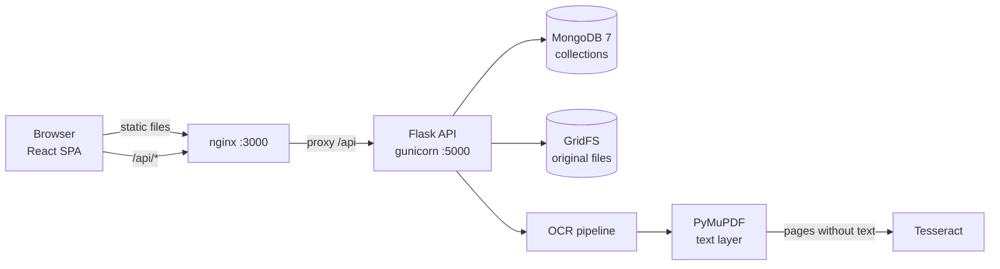
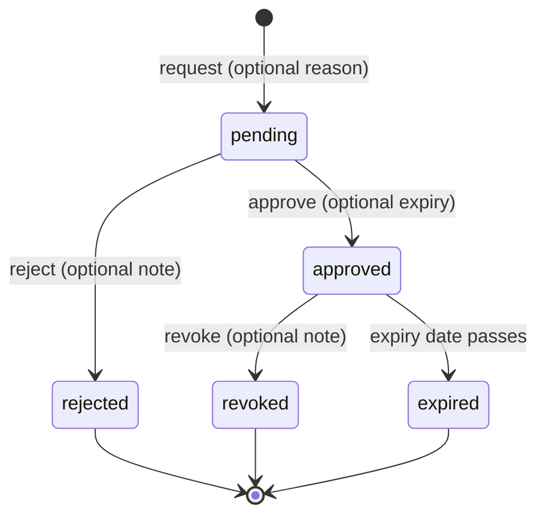

# Architecture

How the system is built: the layers, the data model, the access rules and the OCR and search pipeline.

## Layers

**Frontend.** React 18 with Vite, React Router, Tailwind CSS v4 and shadcn/ui components on Radix primitives. One axios client adds the JWT and logs the user out on any 401. Every screen is lazy loaded, and the metadata fields are fetched once and drive all forms and filters. In Docker the build is served by nginx, which also proxies `/api` to the backend, so the browser talks to one origin.

**API.** Flask 3 with an app factory and one blueprint per area: `auth`, `documents`, `access`, `search`, `catalog`, `stats`, `admin` and `health`. Every request body and query string is validated by a Pydantic v2 model, and every error has the same `{ "error": "<code>", "message": "..." }` shape. Gunicorn runs three workers.

**Storage.** MongoDB holds the records, and GridFS holds the uploaded files, so there is one system to back up and nothing on local disk. Indexes are created at startup. The per-field metadata indexes are re-synced whenever an admin changes a field.

**OCR.** It runs inside the upload request, so the response already says whether text was found. PyMuPDF reads the text layer without any external tools, and Tesseract (installed in the backend image) reads only what has no text layer.

## Data model

| Collection | Key fields |
|---|---|
| `divisions` | `name` (unique), `code` (unique when set), `description`, `created_at` |
| `users` | `name`, `email` (unique, lowercase), `username` (unique when set), `password_hash`, `division` (name), `role` (`member` or `admin`), `created_at`, `last_login_at` |
| `metadata_fields` | `key` (unique), `label`, `type`, `options`, `required`, `filterable`, `searchable`, `order`, `active`, `source` (`divisions` for the built-in Division field), `locked` |
| `documents` | `title`, `filename`, `content_type`, `size`, `sha256`, `gridfs_id`, `division`, `metadata` ({key: value}), `search_blob`, `ocr_text`, `ocr_status`, `ocr_error`, `page_count`, `uploaded_by`, `upload_source`, `created_at` |
| `access_requests` | `document_id`, `document_title`, `requester_id`, `requester_division`, `owner_division`, `reason`, `status`, `decided_by`, `decision_note`, `decided_at`, `expires_at`, `revoked_by`, `revoke_note`, `revoked_at`, `created_at` |
| `audit_logs` | `action` (e.g. `document.download`, `access.approve`, `auth.login_failed`), `actor_id`, `actor_name`, `actor_division`, `target_type`, `target_id`, `division`, `details`, `ip`, `created_at` |
| `fs.files`, `fs.chunks` | GridFS storage for the original files |

**Why definitions plus values.** Metadata is split in two. `metadata_fields` holds the definitions: what a field is called, its type, its options and how it behaves. Each document stores only its values in one `metadata` object keyed by the field's key. Adding a field is an insert into `metadata_fields`, with no schema migration and no code change. Validation, forms and filters read the definitions at runtime. Old documents keep values for fields that are later hidden, because deleting a field only sets `active: false`.

**Keeping filters and indexes dynamic.**
- Filters are generic: any non-reserved query parameter becomes a condition on `metadata.<key>`, converted to the field's type.
- Speed comes from `sync_metadata_indexes`, which creates or drops one index per active filterable field. It runs at startup and after every field change.
- The text index covers `title`, `search_blob` (all searchable metadata values joined) and `ocr_text`. It has fixed field names, so it never needs rebuilding when fields change.

`document.division` and `metadata.Division` always hold the same value, and a division rename updates every record that stores the name.

## Access control

| Action | Member, own division | Member, other division | Super admin |
|---|---|---|---|
| Upload | Yes | No (403) | Any division |
| See title and metadata (list `scope=all`, search) | Yes | Yes | Yes |
| Preview, download, read OCR text | Yes | Only with an approved, unexpired request | Yes |
| Request access | Not needed | Yes, one pending at a time | Not needed |
| Approve, reject or revoke a request | Yes, for their division's documents, never their own request | No | Yes |
| Settings and audit log | No | No | Yes |

Uploads without a token are a special case for the evaluators' script; see [Notes for evaluators](../README.md#notes-for-evaluators).

After a rejection, revocation or expiry the requester can send a new request, which starts again at pending.

## OCR and search

**Extraction** (`app/ocr.py`):
- PDFs are opened with PyMuPDF and each page's text layer is read.
- A page with fewer than 20 characters is treated as a scan. It is rendered at 200 dpi and read by Tesseract (`OCR_LANGUAGES`, English by default).
- At most `OCR_MAX_PAGES` (25) scanned pages are OCR'd per upload, with `OCR_PAGE_TIMEOUT` (60 seconds) per page. Stored text is capped at 2 million characters.
- Images go to Tesseract directly; multi-page TIFFs frame by frame.
- Tesseract never sees more than 10 megapixels: larger images and very large PDF pages are scaled down first (an A4 page at 300 dpi, 8.7 megapixels, passes untouched). JPEGs are decoded straight at a reduced scale. Other formats above 36 megapixels can't be, so they are stored without text and a clear `ocr_error`. MuPDF's image cache is emptied after each OCR'd page. Together this keeps one OCR job within a few hundred MB, so the API fits a 512 MB server (see [DEPLOYMENT.md](DEPLOYMENT.md#free-tier-notes)).
- Any failure (an encrypted PDF, a PDF with no pages, a Tesseract timeout) is caught. The document is stored with `ocr_status: "failed"` and the reason in `ocr_error`. `OCR_ENABLED=false` skips extraction and stores `ocr_status: "skipped"`.

**Search** (`app/search.py`, `GET /api/search?q=`):
1. **Text index.** The query runs against the MongoDB text index, weighted title 10, metadata 5, OCR text 1, which matches whole words with stemming.
2. **Partial words.** A second pass with case-insensitive regexes requires every term to appear somewhere, even inside a longer word.
3. **Ranking.** Text-index hits come first by score, then partial-only hits, newest first. Each pass is capped at 500 candidates.
4. **Match locations.** Each candidate is checked to record where it matched: title, which metadata fields, or text inside the file.
5. **Snippets.** About 200 characters around the first content match. Everything is HTML-escaped except the `<mark>` tags around matches, and the frontend renders the parts as text, never as HTML.

**Why other divisions never see OCR text.** For a document you can't open:
- OCR text does not count as a match, so the document only appears if its title or metadata matched.
- No snippet is returned, and the response never includes `ocr_text`.

A search for a codeword that only appears inside another division's file returns nothing, which is what keeps search from leaking content.
