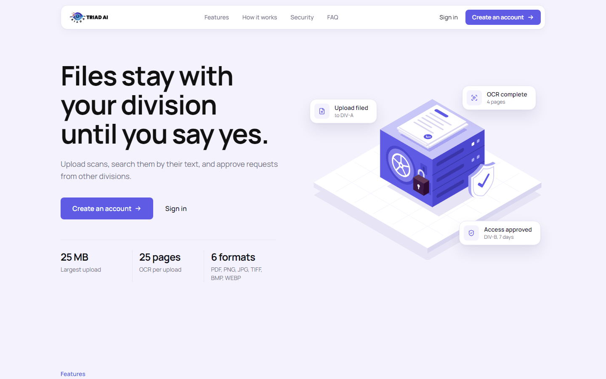
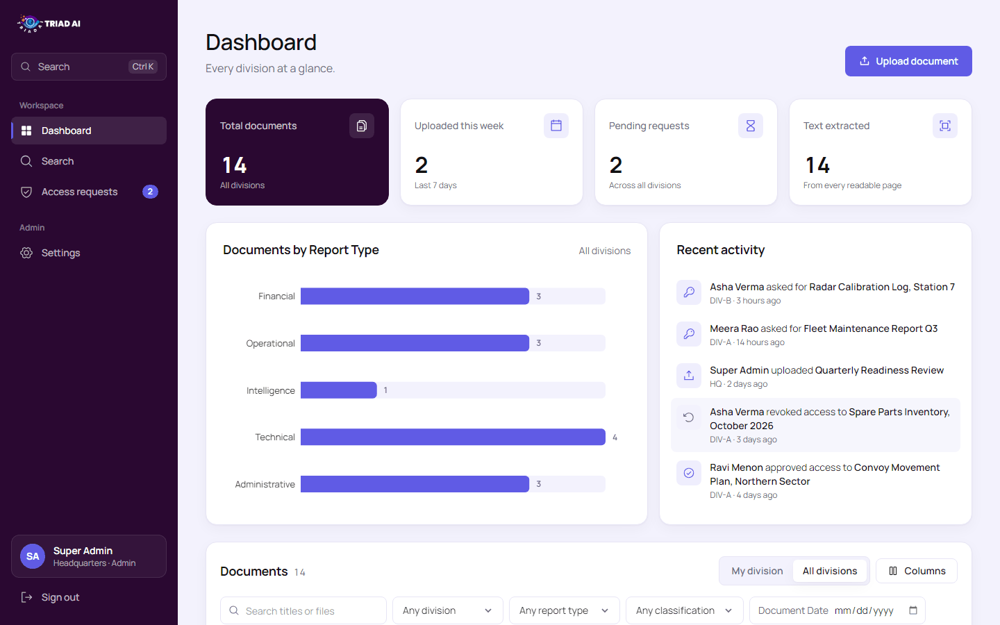
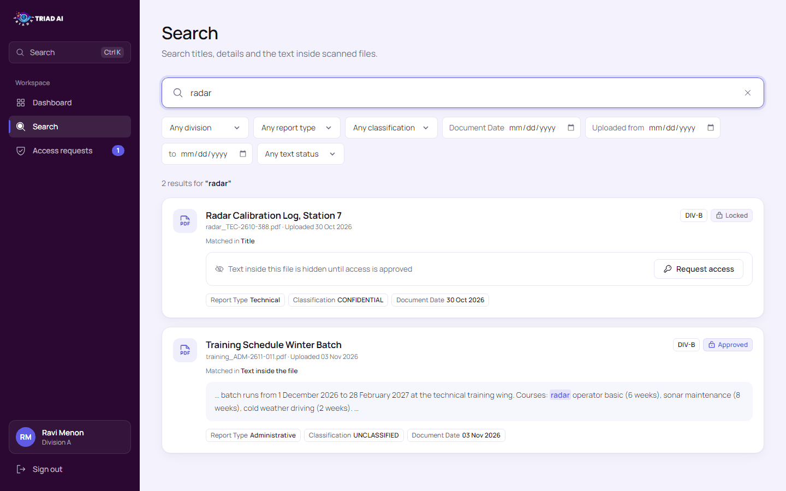
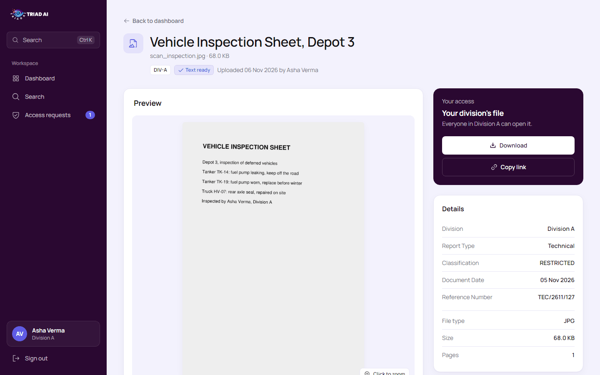
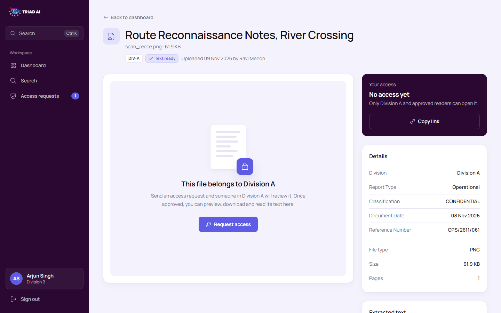
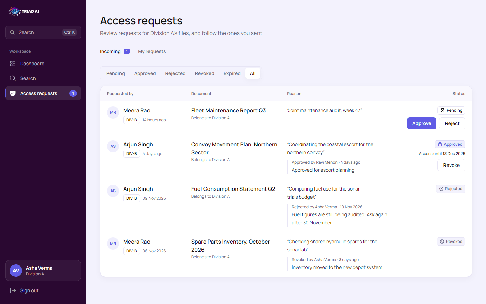
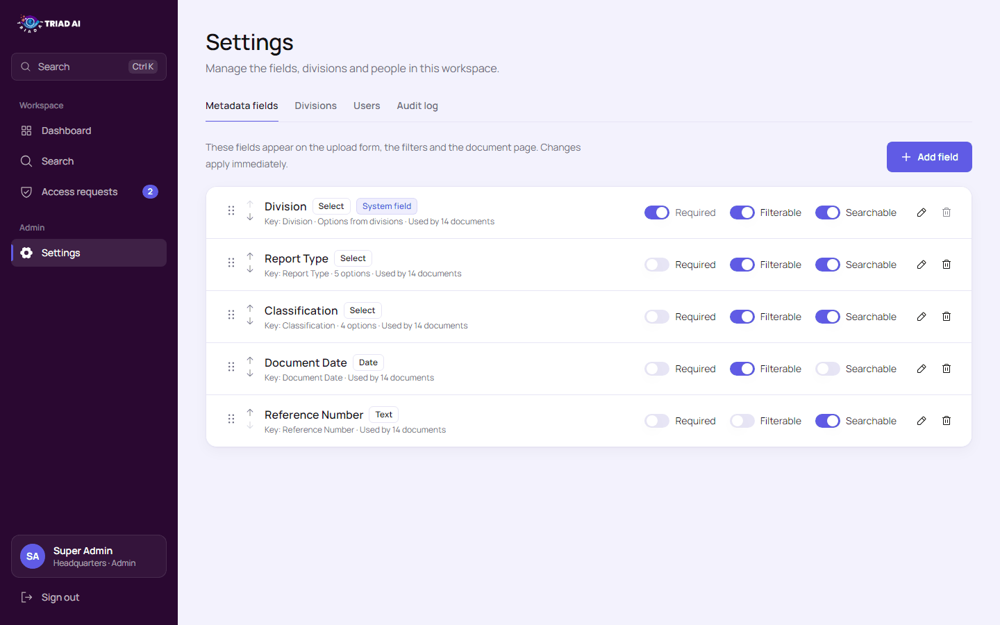
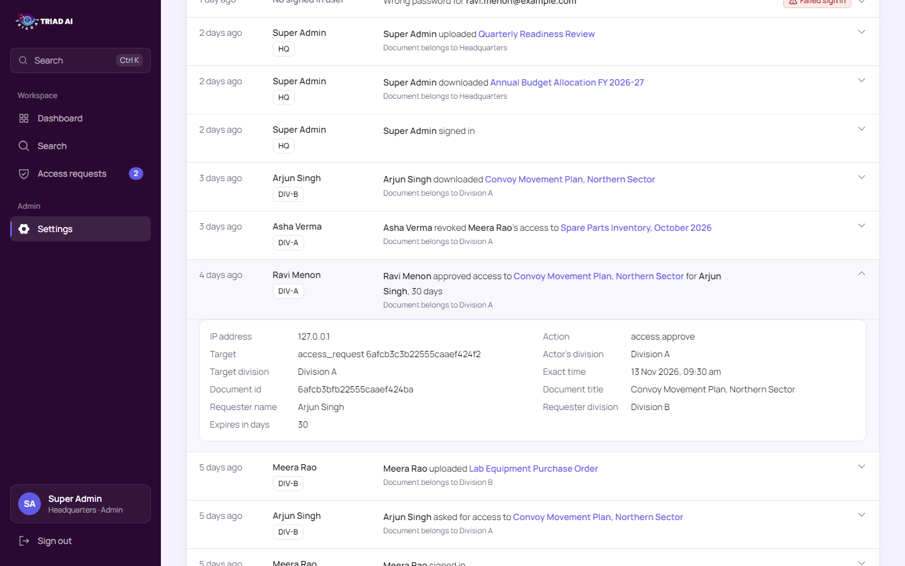
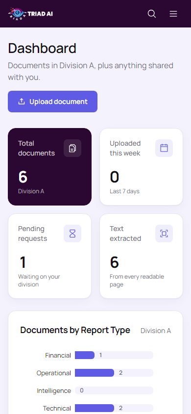

# Screenshots

Captured from the demo data at 1440x900, plus one phone-width view.

**Landing page**, public, with the limits the API really enforces.

| | |
|---|---|
|  **Dashboard** as the super admin: totals, documents by report type, recent activity and the filterable table. |  **Search** as a Division A user: a Division B file shows only its title and details, while a shared file shows its highlighted text. |
|  **Document page** for a scanned JPG, read by OCR, with its details and actions. |  **Locked document** seen from Division B, with the access request call to action. |
|  **Access requests**, incoming tab: pending, approved, rejected and revoked requests with their notes. |  **Settings, metadata fields**: order, type, usage and the three switches per field. |
|  **Audit log** with readable entries and one expanded to show its raw details. |  **Dashboard at 390px** wide. |
